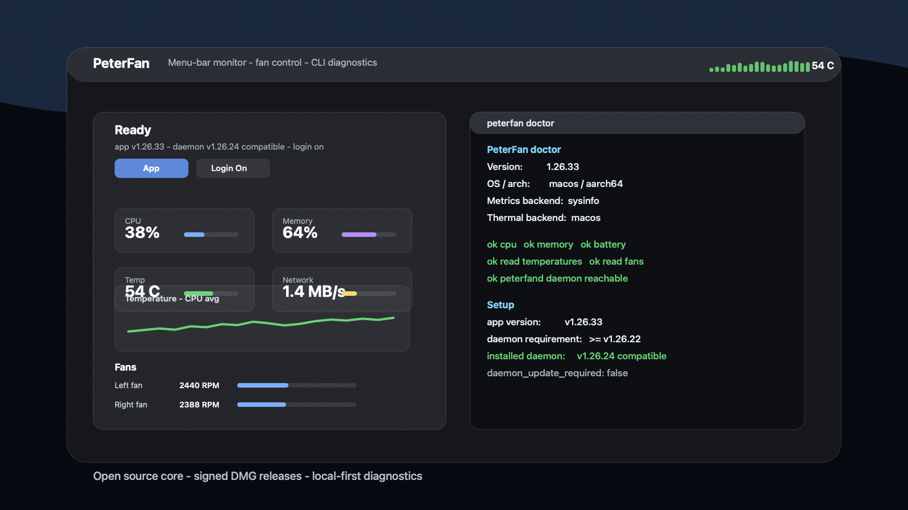

# PeterFan

[English](./README.md) | [한국어](./README.ko.md) | **日本語** | [中文](./README.zh.md)

**開発者向けのシステムモニターと Mac ファンコントローラー。**
Rust 製の macOS メニューバー / Windows トレイアプリ、CLI、TUI、ローカル HTTP API を提供します。

[](./LICENSE)
[](https://www.rust-lang.org)



## 現在の状態

ベータ版です。2026年10月22日時点の公開リリースは **v1.32.2** です。
ローカル開発版 **v1.32.4** と公開済みアセットは別です。最新版とダウンロード対象は
[GitHub Releases](https://github.com/uulab-official/peterfan/releases) で確認してください。

| 機能 | 対応状況 |
| --- | --- |
| システム監視 | macOS / Windows の実際の CPU、メモリ、ディスク、ネットワーク、プロセス、バッテリー情報。取得できる項目は環境に依存します。 |
| macOS センサー | SMC / IOHID による温度とファン RPM。CPU Core Average を中心に、詳細画面で各センサーを確認できます。 |
| macOS ファン制御 | 手動設定、プロファイル、カーブ、デーモンによる継続制御。対応モデルと明示的な管理者セットアップが必要です。 |
| Windows センサー | ファームウェアが公開する ACPI 温度ゾーンに対応。これはシステム温度であり、CPU コア温度ではありません。ファン RPM と制御は未対応です。 |
| メニューバー / トレイ | CPU 負荷に反応するキャラクター、履歴チャート、詳細画面、ライト / ダーク表示。ローカル v1.32.4 にはキャラクター改善とランダム切り替えがあります。 |
| 設定と連携 | TOML 設定、通知、起動設定、JSON 出力、CLI / TUI、ローカル HTTP API。 |
| 更新 | アプリまたは CLI で明示的に確認・インストール。リリースアセットを検証してから置き換えます。 |

全ソースは [MIT ライセンス](./LICENSE) です。アカウント、ログイン、ライセンスキーは不要です。
実センサーを取得できない場合、未対応 / 取得不可、または明示的にシミュレーションと表示します。
モックの成功は実機検証を意味しません。

## インストール

[公開リリース](https://github.com/uulab-official/peterfan/releases) から対応アセットを選びます。

| アセット | 内容 |
| --- | --- |
| `PeterFan-vX.Y.Z.dmg` | macOS アプリと Applications ショートカット。アプリを Applications にドラッグして起動します。 |
| `peterfan-vX.Y.Z-universal-apple-darwin.tar.gz` | macOS Universal の CLI、TUI、デーモン、メニューバーバイナリ、アプリ。 |
| `peterfan-vX.Y.Z-x86_64-pc-windows-msvc.zip` | Windows アプリ、CLI / TUI、ユーザー単位のインストーラー / アンインストーラー、WebView2 ブートストラッパーと説明。 |

macOS の正式配布アセットは Developer ID 署名・公証・ステープルの検証対象です。
ダウンロードした DMG はインストール前に確認できます。

```bash
spctl -a -vv -t open --context context:primary-signature PeterFan-vX.Y.Z.dmg
```

期待する結果は `accepted` と `source=Notarized Developer ID` です。
Gatekeeper が拒否した場合は、新しい署名済みリリースを使うか、ソースからビルドしてください。
署名チェックを回避する手順は推奨しません。

Windows は ZIP を展開し、同梱の `install.ps1` を実行します。

```powershell
powershell -ExecutionPolicy Bypass -File .\install.ps1
```

`%LOCALAPPDATA%\Programs\PeterFan` にインストールされ、スタートメニューに登録されます。
管理者権限は不要です。削除にはインストール先の `uninstall.ps1` を使います。

## ソースから試す

Rust **1.88 以上**、Node.js **22 以上**、macOS では Xcode Command Line Tools を用意してください。
通常のビルド・テストに署名用シークレット、Apple Developer アカウント、管理者権限は不要です。

```bash
git clone https://github.com/uulab-official/peterfan.git
cd peterfan
cargo +stable build --locked -p peterfan-cli
cargo +stable run --locked -p peterfan-cli -- --mock status
cargo +stable run --locked -p peterfan-cli -- --mock --json status
scripts/check-contributor.sh
```

最後のコマンドは整形、Clippy、テスト、ドキュメントなどを確認します。
アプリの起動、デーモンのインストール、ファンへの書き込みは行いません。
Linux / ヘッドレス環境では `scripts/check-contributor.sh --core-only` を使えます。
これはコアの検証であり、ネイティブ UI の検証ではありません。

ネイティブ環境で全バイナリをビルドする場合:

```bash
cargo +stable build --locked --release --workspace
```

実際の監視は `target/release/peterfan status`、診断は
`target/release/peterfan doctor`、センサー一覧は
`target/release/peterfan temps --all` で確認できます。
`target/release/peterfan-menubar` の実行は実際にメニューバー / トレイアプリを起動します。

## ファン制御と安全性

監視は標準で読み取り専用です。macOS の継続的なファン制御は別途 root ヘルパーを
インストールする操作で、管理者の認証が必要です。詳細は
[英語 README](./README.md) と [CLI リファレンス](./docs/CLI.md) を参照してください。
通常の開発やモック実行のためにインストールする必要はありません。

機能チェック、RPM 読み戻し、危険温度への対応、OS 自動制御への復元処理がありますが、
モデルやファームウェアによって制御の結果は異なります。強制終了や電源断を含む
あらゆる障害からの復旧を保証するものではありません。
実機・配布検証は [PRODUCTION_CHECKLIST.md](./docs/PRODUCTION_CHECKLIST.md) で分けて記録します。

## 開発に参加する

- [開発ガイド](./docs/DEVELOPMENT.md): 環境、検証コマンド、副作用のある追加ゲート。
- [CONTRIBUTING.md](./CONTRIBUTING.md): PR とバグ報告、ハードウェア安全性。
- [アーキテクチャ](./docs/ARCHITECTURE.md): コアとプラットフォームの境界。
- [SECURITY.md](./SECURITY.md): 脆弱性の報告。
- [CODE_OF_CONDUCT.md](./CODE_OF_CONDUCT.md): コミュニティでの参加指針。
- [THIRD_PARTY_NOTICES.md](./THIRD_PARTY_NOTICES.md): 外部素材・依存関係のライセンス情報。

詳細な機能とコマンドの共通リファレンスは [English README](./README.md) にあります。
