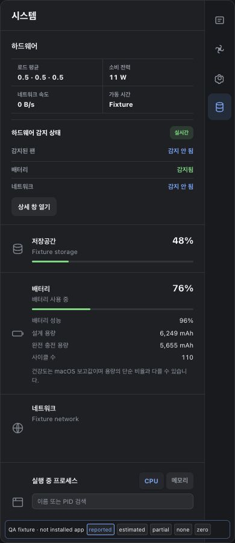

# Battery health and capacity acceptance

Status (2026-10-27): v1.32.11 is publicly released and installed by real 10→11
public-feed OTA on one Mac. Source review, exact PR/main CI, signing/notarization,
native Windows and provider/download/checksum gates pass. Actual installed
battery-screen readback and a fresh final-build six-hour observation are pending.

See the [approved design](superpowers/specs/2026-10-26-battery-health-details-design.md)
and [implementation plan](superpowers/plans/2026-10-26-battery-health-details.md).

## Intended hardware battery information

The existing hardware battery area will show current charge, battery health,
design capacity, current full-charge capacity and cycle count together. Charge
describes the energy currently remaining; health compares the battery with its
new condition. Full-charge capacity is how much it can currently hold when full,
not the current charge level. Capacity readings use explicit matching mAh units.

Reported macOS health takes precedence over a derived full/design estimate.
Calculated health is labeled **Estimated / 추정**. Missing or invalid individual
readings show **Unavailable / 확인 불가**, and a battery-free desktop has a
separate no-battery state. No remaining-years or replacement-date prediction is
made from these readings or cycle count.

## Data and resource boundaries

On the development Mac, macOS reports health 96% and cycle 110. Selected raw
battery observations include design 6249mAh and full-charge 5653mAh, while the
top-level MaxCapacity is normalized 100. A simple physical full/design estimate
therefore differs from the reported macOS health. These are source observations,
not proof that the new installed UI works; values can change before acceptance.

The implementation must not substitute normalized percentage values for physical
capacity. The existing daemon power-rule battery path stays cheap. Numeric
macOS health is requested separately, with a bounded nonblocking System Profiler
probe, long cache interval and cleanup of its own child only. There is no new
worker, timer or sampling thread. Fan control and compatible helper7 stay intact.

The immutable v1.32.11 source is `8b44dc1`; v1.32.10 and all earlier public
tags/assets are preserved.

## Development verification

Feature candidate `7457e8a` passes 589 workspace Rust tests (10 existing/explicit
ignored checks), 104 Node tests and 18 standalone dashboard behavior checks,
strict workspace Clippy, formatting and documentation/OSS checks. The reviewed
portable range fix at `f70b7c7` passes 28 focused dashboard checks after six
observed regression failures. Final PR and main each pass all six required CI jobs. Windows
core/platform all-target cross-compilation passes; this is not native Windows
execution. The read-only native implementation probe reports 96% OS health,
5653/6249mAh full/design capacity and 110 cycles on this Mac.

Final-review fix `4a107df` shares the existing suspend-inclusive Darwin clock
with the battery probe. Cache expiry, pending deadlines and request throttling
include sleep time; unavailable clock readings fail closed. Focused checks pass
19 battery tests (one explicit native probe ignored), six existing clock tests,
the cheap-monitor no-spawn test, targeted Clippy/fmt and Windows platform
cross-compilation. Injected suspend and clock-loss regressions failed before
the fix. Actual physical sleep remains unverified.

CUA runs the actual exported production template with isolated fixture readings:
eight Korean/English320/390px light/dark layouts have no horizontal overflow.
Normal fixture controls verify reported→estimated→absent→partial→zero→reported
states, stale-value clearing, explicit estimate/unavailable labels and real0
charge/cycle visibility. These are fixture checks, not installed-client evidence.

This image is a test fixture, not the installed app or live battery readback.

## Public release and installed readback

Source PR26 merges the reviewed head `191fa43` as main/tag `8b44dc1`; their trees
match. PR CI40285818083/40285818041 and main CI40288288355/40288288369 each pass
all six required jobs. All final-review findings are addressed, including the
suspend-inclusive clock fix and corrected evidence attribution.

Public release424008941 was published at 2026-10-27 04:49:04 KST. Four provider
assets, actual downloads, all three manifest entries and local Mac bytes match.
The app/DMG pass six signature/staple/Gatekeeper checks; four binaries contain
arm64 and x86_64. Native Windows run40293602651 passes actual metrics,
WebView2 signature, install, tray readiness, startup, uninstall and smoke checks.
Unauthenticated public latest/checksum download and prior10/9/8/7 asset identity,
size and digest preservation pass.

The genuine released v1.32.10 CLI queues the public update. Only pinned old app
PID76256 is stopped. Fresh nonce/readiness and installed result identify app11
PID60010, started 2026-10-27 08:49:22 KST; installed app/helper-bundle/Info bytes
match the verified public package and strict installed trust checks pass.
Compatible resident helper7 PID604/start/hash is retained. Doctor reports
healthy, no issues, and ready metrics/thermal/fan control. Auto revisions match,
sensors are fresh, manual targets/overrides are empty and cumulative errors zero.
Natural app11 startup check succeeds at 08:49:42 KST, with persisted history and
next deadline14:49:42 KST (21,600 seconds later).

Before OTA, the only observed configuration byte change was explicit
`primary_visible=true`, equivalent to its prior omitted default. All prior TOML
values and mode0644 match. The original backup is retained separately; OTA
preserves the newly verified raw configuration hash `2ee79feb…17dc1900`.
No writer is inferred from nearby click logs, and no preference is restored.

Read-only native reference at 08:50:07 KST reports macOS health96%, design6249mAh,
full5487mAh and111cycles. This later snapshot differs from the earlier source
probe; readings can vary. These are OS/native reference values, **not verified
installed UI readings**. CUA's current inventory does not expose PeterFan, so
actual battery/style/visibility/click gates stay pending. Calibration/full run
are **NOT STARTED**; no elapsed uptime is counted.

See [sanitized delivery evidence](evidence/2026-10-27-battery-health-v1.32.11.json).

## Acceptance gates

- [x] User-approved inline all-details design and implementation request.
- [x] Read-only source reconnaissance and test drafts preserved during the
      temporary shared-host verification hold; user explicitly resumed work.
- [x] Observed RED→GREEN backend, process-lifecycle and actual UI-function tests;
      local workspace/Clippy/Node/documentation checks.
- [x] Independent task review and scoped re-review: portable estimated-health
      display regression fixed with RED6→GREEN28; no remaining material findings.
- [x] Final whole-branch review, exact-source CI and release metadata.
- [x] CUA fixture checks for Korean/English320/390px and light/dark, including
      estimated, missing, zero cycles, no battery and presence changes.
- [x] New immutable source PR/CI/main/tag and complete signed/notarized Mac plus
      native Windows release; provider, downloads and checksum verification.
- [x] Actual public-feed OTA into the installed app; matching readiness, artifact
      bytes/trust, preserved compatible helper and unrelated configuration.
- [ ] Actual installed hardware battery UI readback against macOS reported
      health and the contemporaneous physical full/design capacities.
- [ ] Strict calibration followed by a fresh continuous 21,600-second observation
      of the final installed version/configuration and independent fixed-limit audit.

Preserve v1.32.10 and all earlier immutable tags/artifacts and raw observations.
The historical v1.32.7 pass, later uptime, test fixtures and calibration add no
time to a new feature's final-build observation. Until actual installed UI access
is available, keep that gate explicitly pending. Scope remains one Mac and the
selected final configuration; other hardware, physical sleep and forced macOS
installation interruption remain unverified.
