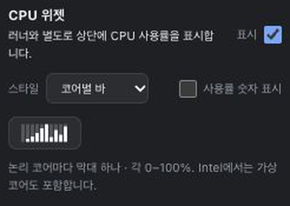

# Per-core CPU widget release and installed acceptance

Status: v1.32.9 source prepared. Public release remains v1.32.8. The per-core
mode is not yet published, installed through OTA or observed for six hours.

## Requested behavior

The user selected an additional **Per-core bars / 코어별 바** mode, approved
the design, and requested the existing deployment/OTA/final-build observation
work to continue. Each logical CPU has a separate 0–100% vertical bar. Entering
the mode hides the optional aggregate percentage, which can be enabled again.
Existing modes, runner and fan-control preferences remain available.

See the [approved design](superpowers/specs/2026-10-25-cpu-per-core-bars-design.md)
and [implementation plan](superpowers/plans/2026-10-25-cpu-per-core-bars.md).

## Source validation

- Real existing `CpuMetrics.per_core` readings feed the same bounded, at-most
  one-second widget sampling path. There is no extra monitor or timer.
- Raster tests cover 1/8/10/18/32/64 CPUs, separate 0/50/100% heights, missing
  readings, non-finite/out-of-range samples, cadence and topology changes.
- Isolated AppKit lifecycle passes eight snapshots, including 10 and 64 cores,
  changed image/item/button widths, percentage, hiding and ownership. Native
  image tests validate variable-width Retina storage and template appearance.
  This example does not open or modify the installed app, config or helper.
- CUA browser QA uses the shared production settings templates with fixture
  readings: Korean 64 cores plus percentage and English 8 cores at 320/390px,
  each in light/dark appearance. Keyboard Space toggles percentage; switching
  History → Per-core bars hides it and acknowledges the simulated save.
  The 320px/64-core case retains all 64 SVG columns, a 516px viewBox, and no page
  overflow: preview 150.797px, graph 99.313px, number 26.484px, children fit.
- Feature behavior checks pass 554 workspace Rust tests and 97 Node tests;
  targeted widget tests pass 14 Rust tests and 10 Node tests. Current config
  module tests pass 18 cases, including the frozen v1.32.8 reader schema.
  Strict workspace Clippy, docs/OSS/dashboard checks and native Homebrew audit
  pass. Exact v1.32.9 source CI remains a separate gate below.
- Initial Node runs retained three unchanged launcher-fixture 10-second timeout
  failures during high host load. A later unchanged-limit serial run passes all
  97 tests. No test timeout, resource threshold or product safety rule changed.
- Fresh independent source review found no confirmed material or minor defects.
  A subsequent compatibility audit found and fixed a shared-config issue with a
  failing regression: old helpers reject a new enum value. Disk TOML now uses
  legacy `style = "bar"` plus `per_core_bars = true`; UI/JSON still use `cores`.
  The frozen old schema and new round trip both pass without a helper reinstall.

The image is a settings fixture, not the installed app or live hardware data.

## Delivery gates

- [x] Approved source implementation, compatibility regression and scoped QA.
- [ ] Exact feature/release-source CI, main integration and immutable v1.32.9 tag.
- [ ] Signed/notarized/stapled universal Mac app/DMG, strict trust checks, native
      Windows acceptance and complete provider/download/checksum verification.
- [ ] Public publication and actual v1.32.8 → v1.32.9 OTA with fresh matching
      native readiness, exact installed bytes and preserved configuration.
- [ ] Actual installed per-core UI/style/click acceptance; final per-core mode
      enabled, percentage off, all non-CPU preferences preserved.
- [ ] Fresh strict calibration and full 21,600-second final-installed-build
      observation, independent audit, documentation and main result integration.

The installed v1.32.8 app, compatible v1.32.7 helper and current settings remain
unchanged during development. Its historical app re-execution and prior v1.32.7
six-hour result contribute no observation time to this feature. Keep all prior
release artifacts and raw results. A single-Mac result cannot establish physical
sleep/forced-install interruption or other-model acceptance.
