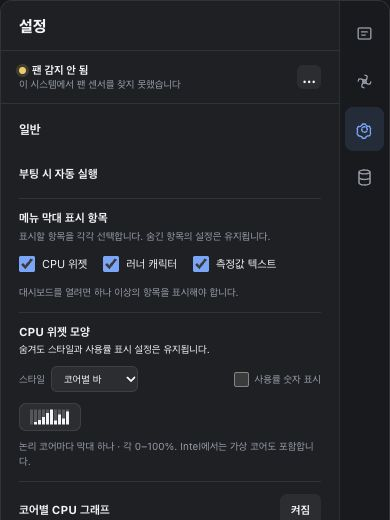

# Independent menu-bar visibility release ledger

Status (2026-10-26): source prepares v1.32.10. The latest verified public release
and installed app remain v1.32.9. New signed publication, actual public OTA,
installed-client acceptance and a fresh six-hour observation are pending.

The user approved independent CPU widget, runner character and metric-text
checkboxes. All seven non-empty combinations are supported. At least one item
stays visible so dashboard access is retained; hidden items keep their appearance,
selected metric and character preferences.

See the [approved design](superpowers/specs/2026-10-26-menu-item-visibility-design.md)
and [implementation plan](superpowers/plans/2026-10-26-menu-item-visibility.md).

## Source and isolated QA

- Existing Number/Runner/Both enum values remain unchanged. A default-on
  `primary_visible` flag permits CPU-only mode without introducing an unknown
  enum value to older resident helpers. Non-CPU/fan preferences are preserved.
- Native items and fallible image resources are prepared before the atomic
  settings save. A failed preparation/save retains the prior live set; successful
  changes preserve native status-item/button identity and runner timer ownership.
- Core/transaction tests cover all combinations, minimum-one protection, strict
  request payloads, migration, old-helper parsing, persistence failure/retry,
  external invalid configurations and unsupported-platform recovery.
- Development verification passes 570 Rust workspace tests and 104 Node tests,
  strict workspace Clippy, formatting and docs/OSS checks. These counts precede
  the final independent review and release-source CI.
- Isolated AppKit QA passes eight CPU presentation snapshots and seven visibility
  transitions, including primary-item hiding/restoration, retained identities and
  last-item rejection. This harness does not operate the installed application.
- CUA tests the actual shared production settings template with fixture readings:
  all seven selections, singleton guards, hidden CPU style preservation, failed
  save/retry, keyboard Space and eight Korean/English 320/390px light/dark layouts.
  Each layout has document width equal to its viewport. Native click anchoring
  in the final installed client remains a separate acceptance gate.

This screenshot is a production-template fixture, not the installed client.

## Delivery gates

- [x] User-approved design and implementation.
- [x] Local source tests and isolated native/browser QA.
- [ ] Independent review, exact final PR/main CI and immutable new version tag.
- [ ] Universal Mac signing/notarization/stapling and strict trust checks.
- [ ] Native Windows package/install/tray/WebView2/startup/uninstall checks.
- [ ] Four provider assets, actual downloads, three checksum entries and old
      public asset preservation independently matched.
- [ ] Public feed and actual installed v1.32.9 → new-version OTA, fresh native
      readiness, exact installed bytes, compatible resident helper and config.
- [ ] Actual installed visibility/settings/click acceptance and agreed final state.
- [ ] Fresh calibration followed by one continuous 21,600-second observation,
      independent fixed-limit audit and final documentation/main integration.

Preserve immutable v1.32.9/v1.32.8 artifacts and every historical raw run. The
earlier v1.32.7 six-hour result and v1.32.9 uptime add no time to this feature.
The host rebooted on 2026-10-26 at 11:12:11 KST before any new observation began;
installed v1.32.9, helper v1.32.7 and configuration hashes were preserved and the
new processes were healthy. This is not a failed six-hour observation.

Final acceptance remains one Mac and the selected final mode/visibility state.
Physical sleep, forced macOS install interruption and other hardware are unverified.
